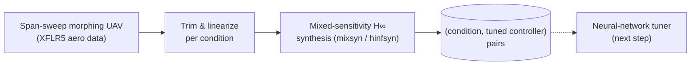

<div align="center">

# Learning-Ready H∞ Control for a Morphing Aircraft

**Mixed-sensitivity H∞ controllers synthesized across the morphing envelope — a data generator for learning to tune controllers.**


</div>

## Why

Hand-tuning a robust controller at every flight and morphing condition does not scale. If tuned controllers can be generated automatically across the envelope, a neural network can learn the mapping **flight condition → controller parameters** and replace the hand-built schedule. This repository is the H∞ side of that idea; the PID version was published as [Gain Scheduling Using Deep Neural Network for Morphing Aircraft](https://jihoonlee91.github.io/papers/2024-dnn-gain-scheduling-morphing-ko.html) (*JKSAS 2024*).

## How it works



- Aircraft: a span-and-sweep morphing UAV (span 3 → 4.5 m, sweep 0 → 40°), aerodynamic coefficients from XFLR5 — the same airframe as the AIAA 2019 and JKSAS 2024 papers below
- Aerodynamic database, nonlinear and linearized aircraft models, mass/inertia distribution
- Baseline **LQR** and **mixed-sensitivity H∞** designs, with trim and eigenvalue/mode analysis across morphing configurations
- Self-contained **nonlinear closed-loop simulation** in `nonlinearSIM/`

## Quick start

```matlab
main      % top-level entry point
example   % smaller worked example
```

<details>
<summary><b>Repository layout</b></summary>

**Aircraft model** — `aero_data.m`, `aero_model.m`, `aerodyn.m`, `aero_coeff.mat` (aero database and model); `lti_model.m`, `lin_mod.m`, `model_lon.m`, `state_eq.m`, `state_eq_lin.m`, `rigiddyn.m` (nonlinear and linearized models); `mass_dist.m`

**Controller design** — `lqr_design.m` (baseline LQR); `mixsyndesign.m` (mixed-sensitivity H∞ via LPVTools); `trim_calc.m`, `trim_cost.m`, `morphing_eig.m` (trim and mode analysis)

**Simulation** — `model.slx`, `gtm_design.slx`; `main.m`, `example.m`; `nonlinearSIM/` (self-contained nonlinear closed-loop simulation)

**Plotting** — `plot_aero.m`, `plot_mode.m`, `plot_result.m`, `plot_result_2.m`, `plot_step.m`, `plot_trim_lpv.m`, `plot_trimx.m`, `polezeromap.*`

`LPVToolsV1.0/` is vendored in the root and in `nonlinearSIM/`, since each is self-contained.

</details>

## Related publications

| | Publication |
|---|---|
| Same aircraft — LPV control | [Linear Parameter-Varying Control of Variable Span-Sweep Morphing Aircraft](https://jihoonlee91.github.io/papers/2019-lpv-variable-span-sweep-morphing.html) — *AIAA SciTech 2019* |
| Same aircraft — same idea with PID | [Gain Scheduling Using Deep Neural Network for Morphing Aircraft](https://jihoonlee91.github.io/papers/2024-dnn-gain-scheduling-morphing-ko.html) — *JKSAS 2024* |

GitHub's **Cite this repository** button uses [`CITATION.cff`](CITATION.cff).

## License

The bundled LPVTools v1.0 (MUSYN Inc. / University of Minnesota) is licensed under the GNU AGPL-3.0 — see `LPVToolsV1.0/agpl-3.0.txt`.

<sub>Part of my morphing-aircraft control research at the Seoul National University Flight Dynamics and Control Lab — more at <a href="https://jihoonlee91.github.io/">jihoonlee91.github.io</a>.</sub>
